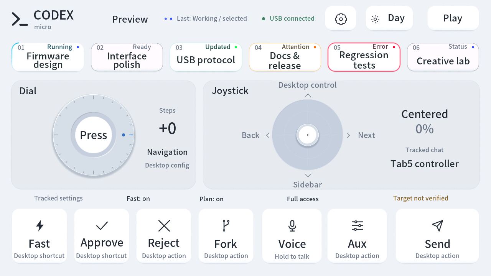
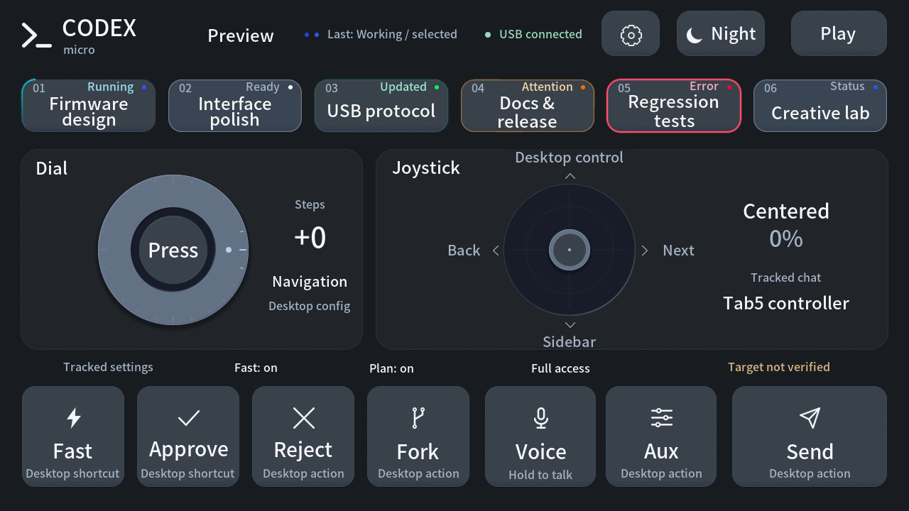

# Tab5 Codex Micro

[简体中文](README.md) · **English**

Turn **M5Stack Tab5** into a touch controller for Codex. It preserves Micro's dial, joystick, and key interactions, and adds chat metadata, two themes, sound, and games to the 5-inch 1280×720 touchscreen.

This is experimental third-party compatible firmware, unaffiliated with OpenAI, M5Stack, or Work Louder. Current version: **0.11.1**.

## Download and flash

Open the [0.11.1 Release](https://github.com/atovk/tab5-codex-micro/releases/tag/v0.11.1), download **`tab5-codex-micro-0.11.1.zip`**, and extract the entire archive. It includes compiled firmware, the title font, a flashing helper, checksums, and Chinese/English instructions. **No PlatformIO installation or compilation is required.**

You need Python **3.11+**, a USB-C data cable, and an ESP32-P4 **M5Stack Tab5 with 16MB flash and 32MB PSRAM**. The commands below target macOS/Linux; the Windows flashing workflow has not been verified.

Run inside the extracted directory:

```sh
python3 -m venv .venv
.venv/bin/python -m pip install -r requirements-flash.txt
.venv/bin/python flash.py --check
.venv/bin/python flash.py --list-ports
.venv/bin/python flash.py --port /dev/cu.usbmodemXXXX
```

Replace the example with the actual Tab5 port from the list; Linux commonly uses `/dev/ttyACM0`. The helper validates the files, enters download mode, writes the firmware and font, and restarts the device. For an initial flash from factory firmware, hold Tab5 Reset for about two seconds until the internal green LED flashes rapidly, release it, then select its P4 download port. Do not flash an ESP32-S3 device.

See the [flashing guide](docs/FLASHING.en.md) for full steps, addresses, updates, and troubleshooting. Flashing replaces existing firmware and resets this project's theme, volume, brightness, and language preferences. Back up flash first if you want to retain the factory system.

## Interface preview

These English UI previews are captured from the 0.11.1 Tab5 framebuffer. Chat titles and states use isolated demonstration data. Switch between Chinese and English in device settings. Tracked chat settings appear in a separate read-only strip, as described below.

| Day | Night |
| --- | --- |
|  |  |

## Features

- **Native Micro interactions:** rotate around the dial's outer ring; tap or hold its center. The joystick sends continuous direction and distance and returns to center on release. The desktop app applies its Micro mappings.
- **Chat keys:** six Agent keys show host lighting states and animated activity borders. A local companion can add titles for explicitly assigned chats.
- **Two-line titles:** Chinese and English wrap at the normal font size. Longer titles scroll slowly in a loop, pause during touch, and resume after release.
- **Separate chat settings strip:** an optional bridge displays the designated chat's accepted settings for its next send: Fast/Standard, Plan/Default, and permission presets including **Full access**. The strip is read-only; missing or expired metadata is unknown. These values no longer serve as the states of the native Fast/Plan/Approve buttons.
- **Two languages and themes:** the console, settings, and games support Chinese/English and matching light-metal/dark-graphite themes. A full flash defaults to English; the selected language survives ordinary restarts.
- **Subtle sound and preferences:** short sounds accompany keys, dial steps, and joystick actions. Volume, mute, brightness, and language are adjustable and survive restarts.
- **Automatic orientation:** the IMU selects between two landscape orientations and updates touch coordinates. Screw holes down is the default reference. Flat placement, movement, and active touch hold the current orientation.
- **Three offline games:** a space shooter, falling blocks, and a dinosaur runner, with pause, resume, and restart.

## Everyday controls

Connect USB-C to the computer, then configure keys, dial behavior, and voice in **Settings → Codex Micro** in the Codex desktop app.

| Gesture | Behavior |
| --- | --- |
| Rotate around the outer ring | 24 steps per revolution, clockwise/counterclockwise |
| Tap/hold the dial center | Native encoder press/release; the desktop interprets holds |
| Drag the joystick | Continuous direction and distance; direction labels describe default mappings |
| Tap an Agent key | Trigger its corresponding desktop chat shortcut |
| Hold/release a command key | Preserve native press/release, including push-to-talk mappings |
| Sun/moon at the top right | Switch and save the theme |
| Gear at the top right | Volume, mute, brightness, and language |
| Games at the top right | Open the local game library |

Fast/Plan/Approve retain their native desktop behavior; they do not establish that the action targets the chat in the settings strip. The interface explicitly says **Target not verified**. A brief **USB not sent** receipt means submission failed or the queue rejected the event, with no promise of later delivery. **USB submitted** appears only after the USB stack accepts the complete message; it still does not acknowledge desktop execution.

The header's **USB connected** label means that USB is mounted; **Last** lighting describes the last native lighting information received. An observed native session, a current USB connection, and fresh bridge metadata are independent evidence and cannot substitute for each other.

The desktop settings determine the final behavior of dial modes, command keys, joystick actions, and voice. Default voice input uses the **computer microphone**, not the Tab5 microphone. The auxiliary key may be unassigned until separate microphone keys are enabled and configured on the desktop.

## Optional: chat titles and settings bridge

Native Micro HID lighting messages contain neither chat titles nor the current chat's Fast/Plan/permission text. Two local processes supplement this metadata while native USB HID continues to handle input. The companion bridge currently targets **macOS** and requires the source repository and its Python dependencies; it is not required merely to flash the downloaded bundle.

```sh
git clone https://github.com/atovk/tab5-codex-micro.git
cd tab5-codex-micro
python3 -m venv .venv
.venv/bin/python -m pip install -r requirements.txt
```

### Titles for the six Agent keys

Assign local chats to the six keys in desktop **Settings → Codex Micro → Agent keys → Custom assignments**. The companion reads only these explicit assignments; it does not guess the live order of a recent-chat list.

```sh
# Inspect configuration without opening hardware; titles are hidden by default.
.venv/bin/python tools/title_sync.py --dry-run

# Continuously synchronize titles, configuration, and available chat settings.
.venv/bin/python tools/title_sync.py --watch
```

Alternatively, use the macOS login service instead of a foreground `--watch` process:

```sh
.venv/bin/python tools/title_sync_service.py install
.venv/bin/python tools/title_sync_service.py status
.venv/bin/python tools/title_sync_service.py stop --remove
```

The service references this checkout's `.venv` and scripts; reinstall it after moving the repository. For foreground use with multiple Tab5 devices, select `--port`, or set `TAB5_SERIAL_NUMBER` to the full application serial shown by `discover`. The login service expects a unique device by default; configure the environment variable in your own LaunchAgent for multiple devices.

### Real settings for a designated chat

In another terminal, run from the same repository:

```sh
.venv/bin/python tools/chat_state_bridge.py --thread-id CHAT_UUID
```

Replace `CHAT_UUID` with the **local chat UUID** available in its link. Keep the desktop app and `title_sync.py --watch` or the title service running. The bridge subscribes to the chat's accepted settings for the next turn; it does not start chats or send messages.

The **Tracked chat** area identifies the target, and a separate read-only strip displays its settings. **Selecting another chat on the desktop does not automatically change the bridge target**; the bridge also does not redirect native Micro commands to that chat. Fast/Plan/Approve buttons do not change appearance based on tracked values, and the **Target not verified** notice remains visible. The state bridge is a separate foreground process; stop it with Ctrl-C. The title login service does not start it.

### Metadata and privacy

The title companion reads saved key assignments and the required titles. The state bridge retains only the target identity and a limited settings projection, not conversation bodies or tool output. Its cache lives in `~/Library/Caches/Tab5 Codex Micro/`. Ordinary logs omit titles. Explicit diagnostics such as `--show-titles`, `--once`, and device `STATUS` can contain titles or chat identifiers; inspect them before sharing.

## Games

| Game | Controls |
| --- | --- |
| Space shooter | Drag the ship; firing is automatic. Collisions and missed enemies cost lives |
| Falling blocks | Left, rotate, right, soft drop, hard drop; hold to repeat, with a landing preview |
| Dinosaur runner | Tap the field or jump key to clear cacti; speed increases with distance |

Games run locally without sending game controls to the computer. Leaving a game immediately pauses and retains the run. Even a quick exit and return keeps it paused until you choose to resume. High scores last until restart.

## Build from source

After preparing the source checkout and Python environment above:

```sh
.venv/bin/python tools/prepare_platform.py
.venv/bin/pio run
.venv/bin/python tools/build_title_font.py
.venv/bin/python tools/verify_device.py discover
.venv/bin/python tools/flash.py --port /dev/cu.usbmodemXXXX --skip-build \
  --font-image artifacts/tab5-title-font-v1.bin
```

The source flashing helper validates the complete firmware version and P4 image layout, then reads the selected chip's base MAC before writing. It checks identity continuity when moving from the application into ROM. After restart, the same chip's application serial must return an exact matching `STATUS` firmware version; another connected Tab5 cannot satisfy verification. Release-bundle validation also requires an exact version and rejects RC or longer version strings mislabeled as the stable release.

Development primarily targets macOS and requires Git and a working C++ compiler. Toolchains are isolated in `.pio-core/`; the first font generation needs internet access. Include the complete title font on the first flash. Later, `tools/flash.py --port PORT` can update firmware while retaining the font; factory-image updates still reset local preferences.

| Component | Pinned version |
| --- | --- |
| pioarduino platform | 55.03.312-1 |
| Arduino-ESP32 | 3.3.12 |
| M5Unified | 0.2.28 |
| M5GFX | 0.2.35 |

## Checks and development

```sh
.venv/bin/python -m unittest discover -s tests -v
.venv/bin/python tools/verify_device.py status
.venv/bin/python tools/verify_device.py hid-status
.venv/bin/python tools/verify_device.py screenshot artifacts/tab5-screen.png
```

`hid-status` only requests state; it does not trigger keys. Input, metadata, fonts, and scrolling have host-side logic tests. Device tools cover touch, pixel restoration, sound, and themes. The new `tools/verify_transition_performance.py` measures theme, language, settings, and game-page transitions plus initial title-cache construction. It isolates native inputs and reads metrics after each completed transition, without treating command acknowledgement time as complete render time. See the [development notes](docs/development.en.md) for architecture, protocol boundaries, and validation methods.

## Current limits

- This third-party protocol implementation may be affected by desktop updates. Incompatible state interfaces or expired metadata show unknown rather than substituting saved defaults for real state.
- Live settings follow one designated local chat. Agent titles require saved Custom assignments. Automatic following of desktop selection, remote chats, and reliable title matching for dynamic recent lists are not implemented.
- The settings strip describes the **designated chat's next send**, not a running turn or the current target of native buttons. USB submission, a historical native session, and fresh bridge data cannot independently prove desktop execution.
- Activity labels are inferred from desktop lighting colors; custom colors may affect them. Custom input mappings remain controlled by the desktop.
- Titles use the BMP coverage of Noto Sans SC. Unsupported characters, including some emoji, are replaced individually. Each title is limited to **191 UTF-8 bytes**; received text beyond two lines scrolls. Changing UI language does not translate chat titles.
- Automatic rotation supports two landscape orientations, with no portrait layout.
- Firmware disables battery charging, the idle radio module, and external power outputs to limit computer USB load. It does not charge the battery while running.

## License and references

Original code is under the [MIT License](LICENSE). Fonts use the SIL Open Font License; TinyUSB and other dependencies retain their licenses. See [third-party notices](THIRD_PARTY_NOTICES.md) and the [font license](licenses/Tab5-UI-Sans-OFL.txt).

- [M5Stack Tab5 documentation](https://docs.m5stack.com/en/core/Tab5)
- [M5Stack USB-C keyboard example](https://github.com/m5stack/M5Tab5-Keyboard-UserDemo)
- [Codex Micro feature guide](https://learn.chatgpt.com/docs/features/codex-micro)
