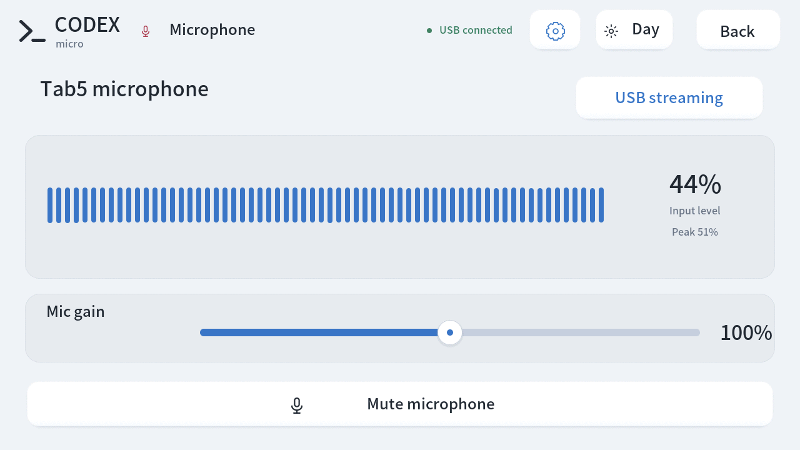

# Tab5 Codex Micro

[简体中文](README.md) · **English**

Turn **M5Stack Tab5** into a touch controller for Codex. It preserves Micro's dial, joystick, and key interactions, and adds chat metadata, two themes, sound, and games to the 5-inch 1280×720 touchscreen.

This is experimental third-party compatible firmware, unaffiliated with OpenAI, M5Stack, or Work Louder. Latest version: **0.13.0 with USB microphone and USB/Bluetooth controls**. Hardware validation scope and known limits are described below.

**0.13.0 adds a USB microphone:** select the onboard Tab5 microphone on your computer and adjust live meters, mute, and gain on the device, with no additional audio driver. Bluetooth microphone audio is deferred; existing Bluetooth controls and title synchronization remain available. See the [microphone guide](docs/MICROPHONE.en.md) for the reason, setup, and measured scope.

## Download and flash

Open the [0.13.0 Release](https://github.com/atovk/tab5-codex-micro/releases/tag/v0.13.0), download **`tab5-codex-micro-0.13.0.zip`**, and extract the entire archive. It includes compiled firmware, the title font, a flashing helper, checksums, and Chinese/English flashing and microphone guides. **No PlatformIO installation or compilation is required.**

You need Python **3.11+**, a USB-C data cable, and an ESP32-P4 **M5Stack Tab5 with 16MB flash and 32MB PSRAM**. The flashing helper supports macOS/Linux. Windows supports offline `--check` only; flashing is not supported.

Run inside the extracted directory:

```sh
python3 -m venv .venv
.venv/bin/python -m pip install -r requirements-flash.txt
.venv/bin/python flash.py --check
.venv/bin/python flash.py --list-ports
.venv/bin/python flash.py --port /dev/cu.usbmodemXXXX
```

Replace the example with the actual Tab5 port from the list; Linux commonly uses `/dev/ttyACM0`. The helper validates the files, enters download mode, writes the firmware and font, and restarts the device. For an initial flash from factory firmware, hold Tab5 Reset for about two seconds until the internal green LED flashes rapidly, release it, then select its P4 download port. Do not flash an ESP32-S3 device.

See the [flashing guide](docs/FLASHING.en.md) for full steps, addresses, updates, and troubleshooting. The default full flash replaces existing firmware and resets this project's bonds, theme, volume, brightness, and language preferences. Back up flash first if you want to retain the factory system. The firmware uses compatible firmware already on Tab5's onboard C6; you do not need to flash the C6 separately or flash other connected development boards.

## Interface preview

These are real Tab5 framebuffer captures of the 0.13.0 microphone page in English. Switch between Chinese and English in device settings. See the [USB microphone guide](docs/MICROPHONE.en.md) for setup.

| Light | Dark |
| --- | --- |
|  |  |

Historical 0.12.0 console captures remain below. Chat titles and states use isolated demonstration data to show the layout; these are not evidence of fresh Bluetooth execution tests. Tracked chat settings appear in a separate read-only strip.

| Light console (0.12.0) | Dark console (0.12.0) |
| --- | --- |
|  |  |

## Features

- **USB/Bluetooth support:** native keys, dial, joystick, and lighting can use USB HID or BLE HID. Device settings provide a pairing PIN, saved bonds, and reconnection. Bluetooth Fast/Plan desktop changes and metadata synchronization retain the 0.12.0 hardware baseline. This round checked enumeration and bond retention only; validation limits are described below.
- **Native Micro interactions:** rotate around the dial's outer ring; tap or hold its center. The joystick sends continuous direction and distance and returns to center on release. The desktop app applies its Micro mappings.
- **Chat keys:** six Agent keys show host lighting states and animated activity borders. A local companion can add titles for explicitly assigned chats.
- **Two-line titles:** Chinese and English wrap at the normal font size. Longer titles scroll slowly in a loop, pause during touch, and resume after release.
- **Separate chat settings strip:** an optional bridge displays the designated chat's accepted settings for its next send: Fast/Standard, Plan/Default, and permission presets including **Full access**. The strip is read-only; missing or expired metadata is unknown. These values no longer serve as the states of the native Fast/Plan/Approve buttons.
- **Two languages and themes:** the console, settings, and games support Chinese/English and matching light-metal/dark-graphite themes. A full flash defaults to English; the selected language survives ordinary restarts.
- **Subtle sound and preferences:** short sounds accompany keys, dial steps, and joystick actions. Volume, mute, brightness, and language are adjustable and survive restarts.
- **Onboard USB microphone:** select **Tab5 Microphone**, a standard UAC1 input with 16kHz, 16-bit mono audio. The microphone page offers meters, mute, and gain. Voice keeps its desktop mapping without automatically choosing a source. Bluetooth does not carry microphone audio.
- **Automatic orientation:** the IMU selects between two landscape orientations and updates touch coordinates. Screw holes down is the default reference. Flat placement, movement, and active touch hold the current orientation.
- **Three offline games:** a space shooter, falling blocks, and a dinosaur runner, with pause, resume, and restart.

## Everyday controls

Connect USB-C, or pair Bluetooth using the steps below. Configure keys, dial behavior, and voice in **Settings → Codex Micro** in the Codex desktop app.

| Gesture | Behavior |
| --- | --- |
| Rotate around the outer ring | 24 steps per revolution, clockwise/counterclockwise |
| Tap/hold the dial center | Native encoder press/release; the desktop interprets holds |
| Drag the joystick | Continuous direction and distance; direction labels describe default mappings |
| Tap an Agent key | Trigger its corresponding desktop chat shortcut |
| Hold/release a command key | Preserve native press/release, including push-to-talk mappings |
| Sun/moon at the top right | Switch and save the theme |
| Gear at the top right | Volume, mute, brightness, language, Connections, and Microphone |
| Games at the top right | Open the local game library |

Fast/Plan/Approve retain their native desktop behavior; they do not establish that the action targets the chat in the settings strip. The interface explicitly says **Target not verified**. A brief **USB not sent** or **BLE not sent** receipt means submission failed or the queue rejected the event, with no promise of later delivery. **USB submitted** or **BLE submitted** only means that the corresponding transport stack accepted the complete message; it does not acknowledge desktop execution.

The header distinguishes USB and Bluetooth connections; **Last** lighting describes the last native lighting information received. An observed native session, a current transport connection, and fresh bridge metadata are independent evidence and cannot substitute for each other.

The desktop settings determine the final behavior of dial modes, command keys, joystick actions, and voice. Using the USB microphone requires selecting **Tab5 Microphone** in the computer or application. The Voice key does not switch audio sources or prove that Codex has started recording. With a Bluetooth-only connection, continue using the computer microphone. The auxiliary key may be unassigned until separate microphone keys are enabled and configured on the desktop.

## Bluetooth pairing and reconnection

Hardware tests for 0.12.0 have verified PIN pairing, reconnection after application updates that preserve bonds, and desktop Fast/Standard and Default/Plan changes followed by restoration with only Bluetooth connected. Clockwise and counterclockwise dial events triggered desktop navigation highlighting, confirmed through native blue lighting feedback and four Tab5 frames. Metadata stress tests, automatic USB/BLE switching in both the foreground companion and installed login service, and native/metadata recovery after turning Tab5 Bluetooth off and on have also passed. Specific DOM focus, control identity, battery runtime, computer Bluetooth toggling, and long sleep remain unconfirmed. See the [Bluetooth guide](docs/BLUETOOTH.en.md) for setup and evidence by test case.

1. On Tab5, open **Gear → Connections**, turn Bluetooth on, and tap **Start pairing**. The window for pairing a new computer lasts two minutes.
2. In the computer's Bluetooth settings, select the name shown on Tab5 (`Tab5 Micro` followed by four characters). Immediately enter the **six-digit PIN displayed on Tab5**, including leading zeroes. macOS may show a standalone pairing dialog. The SMP transaction times out after about 30 seconds; the two-minute admission window does not extend it. The PIN is not a fixed default password. After a timeout, close the old prompt and restart pairing.
3. After pairing, check the device and configure mappings in Codex Micro settings. Saved bonds allow automatic reconnection; an ordinary restart or turning Bluetooth off and on does not require pairing again.
4. A USB data connection takes priority. Unplugging it lets ready Bluetooth take over; reconnecting USB restores wired input. Old key events, turns, and partial gestures are not replayed onto the new connection.

To change computers or repair a stale bond, tap **Forget pairing** on Tab5 and confirm, remove the old pairing record on the computer, and pair again. Bluetooth replaces the data link; Tab5 still needs a battery or suitable power source. Firmware keeps battery charging disabled, and battery runtime has not been validated.

## Optional: chat titles and settings bridge

Native Micro HID lighting messages contain neither chat titles nor the current chat's Fast/Plan/permission text. Two local processes supplement this metadata while native USB/BLE HID handles input and lighting. The companion bridge currently targets **macOS** and requires the source repository and its Python dependencies; it is not required merely to flash the downloaded bundle. Wireless metadata uses a separate encrypted GATT service. A native Bluetooth connection alone does not supply titles or chat settings.

```sh
git clone --branch v0.13.0 https://github.com/atovk/tab5-codex-micro.git
cd tab5-codex-micro
python3 -m venv .venv
.venv/bin/python -m pip install -r requirements.txt
```

### Titles for the six Agent keys

Assign local chats to the six keys in desktop **Settings → Codex Micro → Agent keys → Custom assignments**. The companion reads only these explicit assignments; it does not guess the live order of a recent-chat list.

```sh
# Inspect configuration without opening hardware; titles are hidden by default.
.venv/bin/python tools/title_sync.py --dry-run

# Sync continuously; auto prefers USB, then paired BLE when matching USB is absent.
.venv/bin/python tools/title_sync.py --watch --transport auto
```

Alternatively, use the macOS login service instead of a foreground `--watch` process:

```sh
.venv/bin/python tools/title_sync_service.py install --transport auto
.venv/bin/python tools/title_sync_service.py status
.venv/bin/python tools/title_sync_service.py stop --remove
```

The service references this checkout's `.venv` and scripts; reinstall it after moving the repository. Choose either foreground `--watch` or the login service, rather than running two sync instances. `chat_state_bridge.py` only updates a local cache and does not open another Bluetooth connection.

Use `tools/verify_device.py discover` to identify the P4 application serial, then select it with `--device-serial TAB5-0123456789AB` (replace this example). Adding the option during service installation saves the selection and permits startup without USB. `TAB5_SERIAL_NUMBER` is also supported. A BLE name or C6 radio address cannot replace P4 identity; ambiguous candidates are rejected. `--port` explicitly selects USB and does not fall back to BLE when that port disappears.

`--transport usb` sends metadata only over USB; `--transport ble` sends it only over Bluetooth and **does not force native keys to use Bluetooth**. If a screenshot or flashing tool owns the USB lock, auto skips that heartbeat instead of bypassing the lock over BLE. Wireless tools use a pinned Bleak dependency; see the [Bluetooth guide](docs/BLUETOOTH.en.md) for setup, reconnection, and diagnostic limits.

### Real settings for a designated chat

In another terminal, run from the same repository:

```sh
.venv/bin/python tools/chat_state_bridge.py --thread-id CHAT_UUID
```

Replace `CHAT_UUID` with the **local chat UUID** available in its link. Keep the desktop app and `title_sync.py --watch` or the title service running. The bridge subscribes to the chat's accepted settings for the next turn; it does not start chats or send messages.

The **Tracked chat** area identifies the target, and a separate read-only strip displays its settings. **Selecting another chat on the desktop does not automatically change the bridge target**; the bridge also does not redirect native Micro commands to that chat. Fast/Plan/Approve buttons do not change appearance based on tracked values, and the **Target not verified** notice remains visible. The state bridge is a separate foreground process; stop it with Ctrl-C. The title login service does not start it.

### Metadata and privacy

The title companion reads saved key assignments and the required titles. The state bridge retains only the target identity and a limited settings projection, not conversation bodies or tool output. Its cache lives in `~/Library/Caches/Tab5 Codex Micro/`. Ordinary logs and `--once` without `--show-titles` omit titles. `--show-titles` and device `STATUS` can contain titles or chat identifiers; inspect them before sharing. Metadata is reread after BLE connection and before each message, rather than replaying pre-reconnection state as fresh.

The BLE companion's public serial matching is not cryptographic device authentication and currently cannot prevent an active GATT impersonator from obtaining metadata. See the [device identity boundary](docs/BLUETOOTH.en.md#device-identity-boundary) for the real firmware's encrypted pairing requirements and this limitation.

## Games

| Game | Controls |
| --- | --- |
| Space shooter | Drag the ship; firing is automatic. Collisions and missed enemies cost lives |
| Falling blocks | Left, rotate, right, soft drop, hard drop; hold to repeat, with a landing preview |
| Dinosaur runner | Tap the field or jump key to clear cacti; speed increases with distance |

Games run locally without sending game controls to the computer. Leaving a game immediately pauses and retains the run. Even a quick exit and return keeps it paused until you choose to resume. High scores last until restart.

## Build from source

After preparing the source checkout and Python environment above:

```sh
.venv/bin/python tools/prepare_platform.py
.venv/bin/pio run
.venv/bin/python tools/build_title_font.py
.venv/bin/python tools/verify_device.py discover
.venv/bin/python tools/flash.py --port /dev/cu.usbmodemXXXX --skip-build \
  --font-image artifacts/tab5-title-font-v1.bin
```

The source flashing helper validates the complete firmware version and P4 image layout, then reads the selected chip's base MAC before writing. It checks identity continuity when moving from the application into ROM. After restart, the same chip's application serial must return an exact matching `STATUS` firmware version; another connected Tab5 cannot satisfy verification. Release-bundle validation also requires an exact version and rejects RC or longer version strings mislabeled as the stable release.

Development primarily targets macOS and requires Git and a working C++ compiler. Toolchains are isolated in `.pio-core/`; the first font generation needs internet access. Include the complete title font on the first flash. A default factory update resets bonds and preferences even when the font is retained. Source updates with `tools/flash.py --port PORT --app-only` preserve NVS, bonds, preferences, and the font only when this project's compatible partition layout and a valid title font are already installed and no migration is required. See the [flashing guide](docs/FLASHING.en.md#later-updates).

| Component | Pinned version |
| --- | --- |
| pioarduino platform | 55.03.312-1 |
| Arduino-ESP32 | 3.3.12 |
| M5Unified | 0.2.28 |
| M5GFX | 0.2.35 |

## Checks and development

```sh
.venv/bin/python -m unittest discover -s tests -v
.venv/bin/python tools/verify_device.py status
.venv/bin/python tools/verify_device.py hid-status
.venv/bin/python tools/verify_device.py screenshot artifacts/tab5-screen.png
```

`hid-status` only requests state; it does not trigger keys. Input, metadata, fonts, and scrolling have host-side logic tests. Device tools cover touch, pixel restoration, sound, and themes. The new `tools/verify_transition_performance.py` measures theme, language, settings, and game-page transitions plus initial title-cache construction. It isolates native inputs and reads metrics after each completed transition, without treating command acknowledgement time as complete render time. See the [development notes](docs/development.en.md) for architecture, protocol boundaries, and validation methods.

The 0.13.0 release preparation passed **379 host tests in 65.227 seconds**, built and flashed the final version, and rechecked actual computer audio reception. USB capture, mute, gain, settings persistence, and logical reconnection results are listed in the [microphone guide](docs/MICROPHONE.en.md#capture-and-validation). This round did not repeat every BLE desktop execution check.

The historical 0.12.0 firmware hardware-validation baseline passed **337 host tests**, built successfully, and was flashed to hardware. Final four-frame Bluetooth dial verification passed. The maximum gap between input services during chunked capture was **1.168ms**; the independent BLE test window recorded a maximum input-sampling interval of **16.253ms**. Release preparation, including packaging regressions, passed all **341 host tests in 50.550 seconds**. See the development notes for measurement scope and details.

## Current limits

- This third-party protocol implementation may be affected by desktop updates. Incompatible state interfaces or expired metadata show unknown rather than substituting saved defaults for real state.
- See the [Bluetooth guide](docs/BLUETOOTH.en.md) for verified cases and unconfirmed scenarios. Controlled Fast/Plan, dial navigation highlight, and blue lighting tests do not establish every mapping, specific DOM focus, or other lighting colors. Interface presentation screenshots and historical USB results are not Bluetooth execution evidence.
- Live settings follow one designated local chat. Agent titles require saved Custom assignments. Automatic following of desktop selection, remote chats, and reliable title matching for dynamic recent lists are not implemented.
- The settings strip describes the **designated chat's next send**, not a running turn or the current target of native buttons. USB/BLE submission, a historical native session, and fresh bridge data cannot independently prove desktop execution.
- Activity labels are inferred from desktop lighting colors; custom colors may affect them. Custom input mappings remain controlled by the desktop.
- Titles use the BMP coverage of Noto Sans SC. Unsupported characters, including some emoji, are replaced individually. Each title is limited to **191 UTF-8 bytes**; received text beyond two lines scrolls. Changing UI language does not translate chat titles.
- Automatic rotation supports two landscape orientations, with no portrait layout.
- The firmware enables the onboard C6 as the BLE controller using compatible C6/ESP-Hosted firmware already on the tested Tab5. Other C6 firmware combinations are unverified. Battery charging and external power outputs remain disabled; the device does not charge the battery while running.

## License and references

Original code is under the [MIT License](LICENSE). Fonts use the SIL Open Font License; TinyUSB and other dependencies retain their licenses. See [third-party notices](THIRD_PARTY_NOTICES.md) and the [font license](licenses/Tab5-UI-Sans-OFL.txt).

- [M5Stack Tab5 documentation](https://docs.m5stack.com/en/core/Tab5)
- [M5Stack USB-C keyboard example](https://github.com/m5stack/M5Tab5-Keyboard-UserDemo)
- [Codex Micro feature guide](https://learn.chatgpt.com/docs/features/codex-micro)
