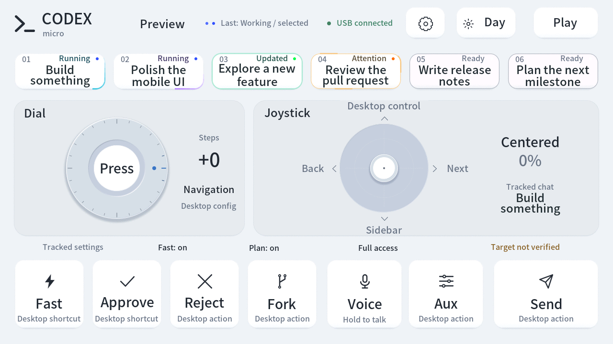
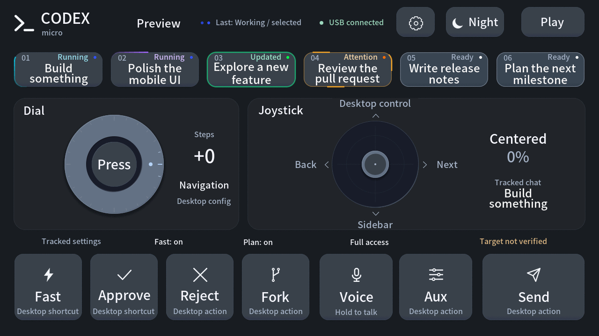

# Tab5 Codex Micro

**简体中文** · [English](README.en.md)

把 **M5Stack Tab5** 变成 Codex 的触摸控制台：保留 Micro 的旋钮、摇杆和按键交互，结合 5 英寸 1280×720 触摸屏，加入聊天状态、双主题、音效和小游戏。

这是第三方实验性兼容固件，与 OpenAI、M5Stack 或 Work Louder 无隶属关系。最新版本：**0.12.0 USB／蓝牙双模**。实机验证范围和已知限制见下文。

当前源码正在开发 **0.13.0-dev.1 USB 麦克风**，让电脑通过标准 USB 音频输入使用 Tab5 板载麦克风，并提供电平、静音和增益设置。该功能尚未发布，下面的 0.12.0 下载包不包含它。蓝牙麦克风暂不支持，原有蓝牙控制与标题同步保留；原因、步骤与验证范围见 [麦克风说明](docs/MICROPHONE.md)。

## 下载后直接刷入

前往 [0.12.0 Release](https://github.com/atovk/tab5-codex-micro/releases/tag/v0.12.0)，下载并完整解压 **`tab5-codex-micro-0.12.0.zip`**。包内包含编译好的固件、标题字库、刷机工具、校验清单和中英文说明，**无需安装 PlatformIO 或编译代码**。

需要 Python **3.11+**、支持数据传输的 USB-C 线，以及 ESP32-P4 的 **M5Stack Tab5（16MB Flash、32MB PSRAM）**。刷机工具支持 macOS／Linux；Windows 仅可离线运行 `--check`，不支持刷写。

在解压目录执行：

```sh
python3 -m venv .venv
.venv/bin/python -m pip install -r requirements-flash.txt
.venv/bin/python flash.py --check
.venv/bin/python flash.py --list-ports
.venv/bin/python flash.py --port /dev/cu.usbmodemXXXX
```

将示例端口替换为列表中的实际 Tab5 端口；Linux 通常为 `/dev/ttyACM0`。工具会校验文件、进入下载模式、写入固件与字库并重启。初次使用出厂固件时，先按住 Tab5 Reset 约两秒，看到内部绿灯快速闪烁后松开，再选择对应 P4 下载端口。不能刷入 ESP32-S3 设备。

完整步骤、文件地址、后续更新及故障处理见 [刷机说明](docs/FLASHING.md)。默认完整刷入会替换现有固件并重置本项目的绑定、主题、音量、亮度和语言设置；需要保留出厂系统时请先自行备份 Flash。固件使用 Tab5 板载 C6 已有的兼容固件，无需单独刷写 C6 或电脑上连接的其他开发板。

## 界面预览

下图为 0.12.0 的真实 Tab5 帧缓冲截图，界面及示例内容为英文；聊天标题与状态使用隔离的演示数据。它们展示界面效果，不是原生操作已被桌面执行的证据。设备设置页可随时切换中文／English。跟踪聊天的设置位于独立只读状态条，详见下文。

| 白天 | 黑夜 |
| --- | --- |
|  |  |

## 功能

- **USB／蓝牙双模**：原生按键、旋钮、摇杆和灯光可通过 USB HID 或 BLE HID 传输；设备端提供配对 PIN、绑定保存与重连。实机已确认蓝牙 Fast／Plan 桌面切换与元数据同步；完整验证边界见下文。
- **原生 Micro 交互**：沿旋钮外环连续转动，中心支持点按与长按；摇杆输出连续方向与行程，松手归中。事件交给桌面端的 Micro 映射处理。
- **聊天快捷键**：六个 Agent 键，显示主机灯光状态和活动霓虹边框；本地 companion 可补充明确绑定的聊天标题。
- **两行标题**：保留正常字号，中英文自动换行；超过两行后缓慢循环滚动，触摸时暂停，松手后继续。
- **独立的聊天状态条**：可选桥接只读显示指定聊天下一次发送采用的 Fast／Standard、Plan／Default 和权限预设，包括 **Full access**。未同步或过期时显示未知；这些值不再充当 Fast／Plan／Approve 原生按钮的状态。
- **中英双语、日夜主题**：控制台、设置和游戏支持中文／English，浅色金属与深色石墨主题保持统一。完整刷入后默认英文；语言选择在普通重启后保留。
- **轻量音效与设置**：按钮、旋钮和摇杆提供短提示音；音量、静音、屏幕亮度和语言可调整并在重启后保留。
- **板载 USB 麦克风（0.13.0-dev.1 开发中）**：电脑可选择 **Tab5 Microphone** 标准 UAC1 输入，16kHz、16-bit、单声道；麦克风页提供电平、静音与增益。Voice 键保留桌面映射，不自动选择音源；蓝牙不传输麦克风音频。
- **自动方向**：IMU 根据重力方向在两个横屏方向间翻转，同步触摸坐标；螺丝孔朝下为默认方向。平放、晃动或触摸操作时保持方向。
- **三个离线小游戏**：星际守卫、俄罗斯方块、小恐龙跑酷；支持暂停、继续与重开。

## 日常操作

通过 USB-C 连接电脑，或按下节完成蓝牙配对，再在 Codex 桌面应用的 **设置 → Codex Micro** 中配置按键、旋钮与语音行为。

| 操作 | 行为 |
| --- | --- |
| 沿旋钮外环转动 | 每圈 24 个步进，支持顺／逆时针 |
| 点按／长按旋钮中心 | 原生编码器按下／释放，由桌面端解释长按 |
| 拖动摇杆 | 连续方向和距离；方向文字为默认映射提示 |
| 点按 Agent 键 | 触发对应桌面聊天快捷键 |
| 按住／松开命令键 | 保留原生按下／释放，支持按住说话等映射 |
| 右上角太阳／月亮 | 切换并保存主题 |
| 右上角齿轮 | 音量、静音、亮度、语言、“连接”页，以及“麦克风”页（0.13.0-dev.1 开发版） |
| 右上角游戏 | 打开本地游戏库 |

Fast／Plan／Approve 保留桌面原生按键行为，不能据此认定操作的是状态条中的聊天。界面明确显示“**操作目标未核对 / Target not verified**”。按钮短暂显示“USB未发送”或“蓝牙未发送”表示提交失败或队列拒绝，不承诺稍后发送；“USB已提交”或“蓝牙已提交”仅表示完整消息已交给对应传输栈，仍不是桌面执行回执。

页眉区分 USB／蓝牙连接；“最近”灯光是最后收到的原生灯光信息。原生会话曾被观察到、传输当前连接、桥接元数据仍新鲜是三种独立证据，不能相互替代。

旋钮模式、命令键、摇杆和语音行为最终由桌面设置决定。**0.12.0 不提供 Tab5 麦克风音频**。USB 麦克风开发版仍需在电脑或应用中选择 **Tab5 Microphone**；Voice 键本身不切换音源，也不能证明 Codex 已经开始录音。仅通过蓝牙连接时可继续使用电脑麦克风。辅助键默认可能未分配，需要在桌面端启用独立麦克风键并配置。

## 蓝牙配对与重新连接

0.12.0 实机已验证 PIN 配对、保留绑定的应用更新后重连，以及仅有蓝牙连接时 Fast／Standard、Default／Plan 的桌面状态切换与恢复；旋钮顺／逆转已触发桌面导航高亮，并通过原生蓝色灯效回传及 Tab5 四帧显示确认。元数据压力测试、前台与正式登录后台 companion 的 USB／BLE 自动切换和 Tab5 蓝牙关闭再开启后的原生／元数据恢复也已通过。具体 DOM 焦点、控件身份、续航、电脑蓝牙开关与长期休眠等仍未确认。完整步骤和分项证据见 [蓝牙连接说明](docs/BLUETOOTH.md)。

1. 在 Tab5 打开 **齿轮 → 连接 / Connections**，开启 Bluetooth，点击 **开始配对 / Start pairing**。新电脑的配对窗口为两分钟。
2. 在电脑的蓝牙设置中选择 Tab5 显示的设备名（`Tab5 Micro` 加四位后缀），看到提示后立即输入 Tab5 显示的**六位 PIN**，包括前导零。macOS 可能显示独立配对弹窗；SMP 事务约 30 秒超时，两分钟开放窗口不会延长它。PIN 不是固定默认密码；超时后关闭旧提示并重新开始配对。
3. 配对完成后，在 Codex 的 Micro 设置中检查设备并配置映射。已保存的绑定可自动重连；普通重启或关闭再开启蓝牙不要求重新配对。
4. USB 数据连接优先。拔掉数据线后，已就绪的蓝牙接管；重新接回 USB 则恢复有线输入。切换不会把旧按键、旋转或半次手势重放到新连接。

需要更换电脑或修复过期绑定时，在 Tab5 点击 **清除绑定 / Forget pairing** 并确认，再在电脑删除旧配对记录后重新配对。蓝牙替代的是数据连接，设备仍需电池或合适电源；当前固件保持电池充电关闭，尚无续航验证结论。

## 可选：聊天标题和状态桥接

原生 Micro HID 灯光消息不包含聊天标题，也不提供当前聊天的 Fast／Plan／权限文本。本项目通过两个本地进程补充元数据，原生 USB／BLE HID 负责操作与灯光。配套桥接目前面向 **macOS**，需要克隆本仓库并安装源码工具的依赖；下载刷机包本身无需运行桥接。无线元数据使用独立的加密 GATT 服务，原生蓝牙连接本身不会自动带来标题和聊天状态。

```sh
git clone --branch v0.12.0 https://github.com/atovk/tab5-codex-micro.git
cd tab5-codex-micro
python3 -m venv .venv
.venv/bin/python -m pip install -r requirements.txt
```

### 六个 Agent 键的标题

在桌面 **设置 → Codex Micro → Agent keys → Custom assignments** 中为六个键指定本地聊天。companion 只读取明确绑定的聊天，不猜测“最近聊天”的实时排序。

```sh
# 只检查配置，不打开硬件；默认不打印聊天标题。
.venv/bin/python tools/title_sync.py --dry-run

# 前台同步；auto 默认优先 USB，没有匹配 USB 时使用已配对的 BLE。
.venv/bin/python tools/title_sync.py --watch --transport auto
```

也可用 macOS 登录服务替代前台 `--watch`：

```sh
.venv/bin/python tools/title_sync_service.py install --transport auto
.venv/bin/python tools/title_sync_service.py status
.venv/bin/python tools/title_sync_service.py stop --remove
```

服务引用当前仓库的 `.venv` 和脚本；移动仓库后需重新安装。前台 `--watch` 与登录服务二选一，避免启动两个同步实例。`chat_state_bridge.py` 只更新本地缓存，不会另开蓝牙连接。

推荐在 `tools/verify_device.py discover` 中确认 P4 应用序列号，再用 `--device-serial TAB5-0123456789AB` 指定同一芯片（示例值必须替换）。安装服务时加上该参数会保存选择，无 USB 也可冷启动；也支持 `TAB5_SERIAL_NUMBER` 环境变量。BLE 广播名和 C6 无线地址不能替代 P4 身份，多个无法区分的候选会被拒绝。`--port` 强制指定 USB 端口，不会在该端口消失时转向 BLE。

`--transport usb` 仅同步有线元数据；`--transport ble` 仅同步蓝牙元数据，**不会强制原生按键改走蓝牙**。USB 被截图／刷机工具锁定时，auto 跳过本次心跳，不绕过锁改走 BLE。双模工具依赖固定版本 Bleak；安装步骤、自动重连和诊断限制见 [蓝牙连接说明](docs/BLUETOOTH.md)。

### 指定聊天的真实状态

另开终端，在同一仓库运行：

```sh
.venv/bin/python tools/chat_state_bridge.py --thread-id CHAT_UUID
```

将 `CHAT_UUID` 换为要跟踪的**本地聊天 UUID**，可从聊天链接取得。保持桌面应用和 `title_sync.py --watch` 或标题服务运行。桥接订阅该聊天接受的下一轮设置，不启动聊天、不发送消息。

设备在“指定聊天”区域标明跟踪目标，并在独立只读条中显示该聊天的设置。**切换桌面选中的聊天不会自动改变桥接目标**；桥接也不会把原生 Micro 命令重定向到该聊天。Fast／Plan／Approve 按钮不根据跟踪值切换外观，始终保留“操作目标未核对”提示。状态桥接是独立前台进程，按 Ctrl-C 停止；标题登录服务不会代为启动它。

### 元数据与隐私

标题 companion 读取保存的按键分配和所需标题；状态桥接仅保留目标标识及有限设置枚举，不保存对话正文或工具输出。缓存位于 `~/Library/Caches/Tab5 Codex Micro/`。普通日志和未加 `--show-titles` 的 `--once` 输出不打印标题；`--show-titles` 与设备 `STATUS` 可能包含标题或聊天标识，公开前应检查。BLE 连接建立后及每条消息发送前重新读取元数据，不把重连前排队的旧状态当成新状态。

BLE companion 的公开串号匹配不是密码学设备认证，目前不能阻止主动仿冒 GATT 服务获取元数据；真实固件的加密配对要求与该限制见 [设备身份边界](docs/BLUETOOTH.md#设备身份边界)。

## 游戏

| 游戏 | 操作 |
| --- | --- |
| 星际守卫 | 拖动飞船躲避敌机，自动射击；碰撞或漏过敌机会损失生命 |
| 俄罗斯方块 | 左移、旋转、右移、下落与速降；长按连移，轮廓提示落点 |
| 小恐龙跑酷 | 点击场地或跳跃键跨越仙人掌，速度随距离增加 |

游戏在 Tab5 本地运行，不向电脑发送游戏操作。离开游戏立即暂停并保留本局进度，即使快速离开后返回也保持暂停，需要手动继续；最高分保留到重启。

## 从源码构建

完成上述仓库与 Python 环境准备后执行：

```sh
.venv/bin/python tools/prepare_platform.py
.venv/bin/pio run
.venv/bin/python tools/build_title_font.py
.venv/bin/python tools/verify_device.py discover
.venv/bin/python tools/flash.py --port /dev/cu.usbmodemXXXX --skip-build \
  --font-image artifacts/tab5-title-font-v1.bin
```

源码刷机工具校验完整固件版本和 P4 镜像布局，写入前读取选中芯片的基础 MAC；从应用进入 ROM 时核对身份连续性。重启后必须由同一芯片的应用序列号返回完全匹配的 `STATUS` 固件版本，另一台已连接的 Tab5 不会被当成刷机成功。发布包校验同样要求完整版本匹配，不接受把 RC 或更长版本号作为正式版。

开发主要面向 macOS，需要 Git 和可用的 C++ 编译器。项目在 `.pio-core/` 中隔离工具链；字体生成首次需要联网。完整标题字库首次刷入不可省略。默认 factory 更新即使保留字库，也会重置绑定与偏好。只有设备已经安装本项目兼容的分区布局、有效标题字库，且本次更新不要求迁移时，源码工具 `tools/flash.py --port PORT --app-only` 才可保留 NVS、绑定、偏好与字库；详见 [后续更新](docs/FLASHING.md#后续更新)。

| 组件 | 固定版本 |
| --- | --- |
| pioarduino 平台 | 55.03.312-1 |
| Arduino-ESP32 | 3.3.12 |
| M5Unified | 0.2.28 |
| M5GFX | 0.2.35 |

## 检查与开发

```sh
.venv/bin/python -m unittest discover -s tests -v
.venv/bin/python tools/verify_device.py status
.venv/bin/python tools/verify_device.py hid-status
.venv/bin/python tools/verify_device.py screenshot artifacts/tab5-screen.png
```

`hid-status` 仅请求状态，不触发按键。输入、元数据、字体和滚动有主机逻辑测试；触摸、像素恢复、声音和主题有对应实机工具。新增 `tools/verify_transition_performance.py` 可测主题、语言、设置、游戏页面切换和首次标题缓存构建；它隔离原生输入、在切换完成后读取指标，不把命令应答时间当作完整渲染时间。架构、协议边界和验证方法见 [开发说明](docs/development.md)。

0.12.0 固件实机验收时通过 **337 项主机测试**并完成构建与实机刷入。最终蓝牙旋钮四帧复测通过；分块截图期间最大相邻输入服务间隔为 **1.168ms**，独立 BLE 测试窗口的最大输入采样间隔为 **16.253ms**。发布准备加入打包回归后，全套 **341 项主机测试通过（50.550 秒）**。测量范围与详细结果见开发说明。

## 当前限制

- 第三方协议实现可能受桌面升级影响；状态接口不兼容或元数据过期时显示未知，不以默认配置代替真实状态。
- 已验证项目与未确认场景见 [蓝牙连接说明](docs/BLUETOOTH.md)。Fast／Plan、旋钮导航高亮及蓝色灯效的受控验证不代表全部映射、具体 DOM 焦点或其他灯色均已确认。界面展示截图和历史 USB 结果不代表蓝牙执行验证。
- 实时状态仅跟踪指定本地聊天；Agent 标题仅支持已保存的 Custom assignments，未实现桌面选中聊天自动跟随、远程聊天或动态最近列表的可靠标题匹配。
- 状态条表示**指定聊天下一次发送的设置**，不代表已运行回合或原生按钮当前目标。USB／BLE 提交、历史原生会话和新鲜桥接数据都不能单独证明桌面已经执行操作。
- 活动状态由桌面灯光颜色推断，自定义灯色可能影响文字；自定义输入映射仍由桌面决定。
- 标题采用 Noto Sans SC 的 BMP 覆盖，不支持的字符（包括部分 emoji）逐字符替换。每个标题上限 **191 个 UTF-8 字节**；超出两行的已接收文本滚动显示。语言切换不翻译聊天标题。
- 仅支持两个横屏方向，没有竖屏布局。
- 固件启用板载 C6 作为 BLE 控制器，使用本次实测 Tab5 已有的兼容 C6／ESP-Hosted 固件；其他 C6 固件组合尚未验证。保持电池充电和外部供电输出关闭，运行时不会为电池充电。

## 许可与参考

原创代码采用 [MIT License](LICENSE)；字体采用 SIL Open Font License，TinyUSB 和其他依赖保留各自许可。见 [第三方说明](THIRD_PARTY_NOTICES.md) 与 [字体许可](licenses/Tab5-UI-Sans-OFL.txt)。

- [M5Stack Tab5 文档](https://docs.m5stack.com/en/core/Tab5)
- [M5Stack USB-C 键盘示例](https://github.com/m5stack/M5Tab5-Keyboard-UserDemo)
- [Codex Micro 功能说明](https://learn.chatgpt.com/docs/features/codex-micro)
