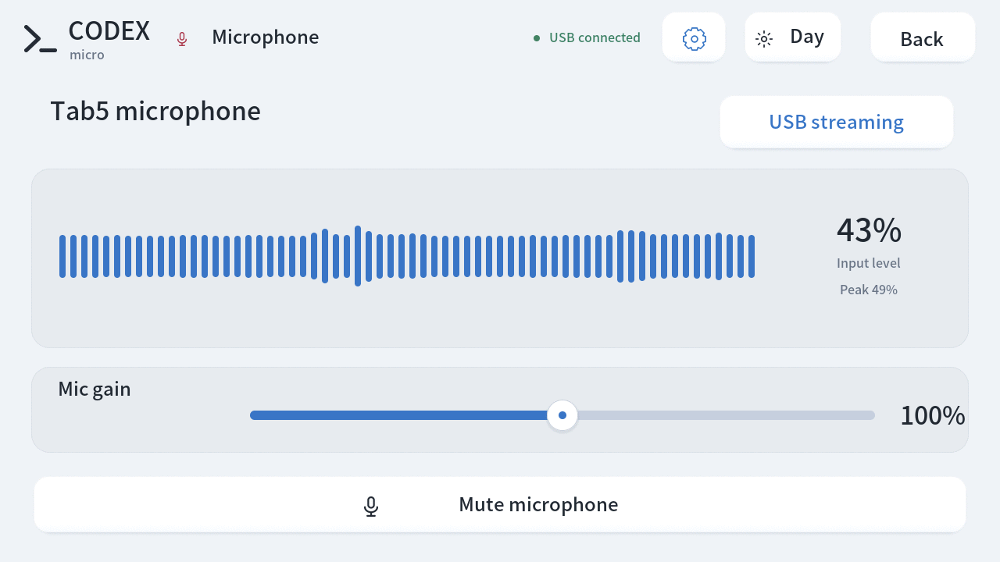
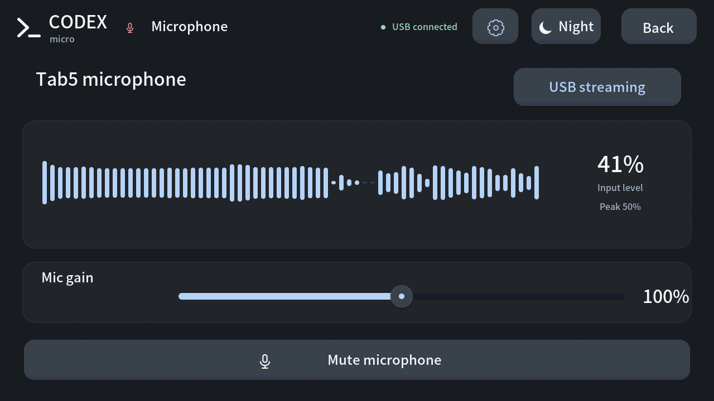

# Tab5 USB microphone

[简体中文](MICROPHONE.md) · **English**

Source version: **0.13.0-dev.1, in development and not released**. The latest public download remains [0.12.0](https://github.com/atovk/tab5-codex-micro/releases/tag/v0.12.0), which does not include this onboard microphone feature. This development build has been built and flashed to Tab5. Measured USB capture, mute, gain, and settings persistence are described below.

## Connect and use

USB provides **Tab5 Microphone**, a standard UAC1 input with **16kHz, 16-bit mono PCM**. Firmware averages the two onboard microphone channels into mono. Acoustic echo cancellation (AEC) and beamforming are not implemented. No project audio bridge or virtual audio driver is needed on the computer.

1. Connect the computer to the **USB-C data port on the Tab5 body**.
2. Select **Tab5 Microphone** in macOS **System Settings → Sound → Input**, or the recording application's input list. If the application uses the system default, select that system input first. Grant microphone access when the application requests it.
3. Open **Gear → Microphone** on Tab5 to check meters, mute, and gain.
4. Then use **Voice** according to the desktop mapping. A USB audio connection, moving meter, or Voice press alone does not establish that a particular application selected Tab5 and started recording.

USB audio needs no title service and can operate alongside CDC synchronization and native Micro HID. Voice keeps its native desktop mapping without automatically choosing a source. A power-only connection or Bluetooth pairing does not establish Tab5 audio input.

## Interface

The microphone page supports light and dark themes. These are English-interface captures from the development firmware running on Tab5.

| Light | Dark |
| --- | --- |
|  |  |

## Why Bluetooth microphone audio is deferred

Tab5's ESP32-C6 provides [Bluetooth LE](https://docs.espressif.com/projects/esp-idf/en/latest/esp32c6/api-guides/ble/overview.html), without Bluetooth Classic. The [HFP profile used by common Bluetooth headsets belongs to Classic](https://docs.espressif.com/projects/esp-idf/en/latest/esp32/api-guides/classic-bt/profiles-protocols.html). Tab5 therefore cannot directly present a conventional Bluetooth headset microphone through HFP. This project also does not implement LE Audio.

Custom BLE audio would require an additional computer audio bridge. On a Mac, a virtual audio device would also be required to make it selectable by recording applications. This adds installation, runtime, and maintenance requirements, so this version provides standard USB microphone audio and defers Bluetooth audio.

**Existing Bluetooth keys, dial, joystick, lighting, and title/chat-state synchronization remain available.** Follow the [Bluetooth guide](BLUETOOTH.en.md) for pairing and automatic reconnection. With a Bluetooth-only connection, continue using the computer microphone. Connect USB and select its input when you want to use Tab5's microphone.

## Meters, mute, and gain

| Display state | Meaning |
| --- | --- |
| USB ready | USB is connected, but the host has not opened audio input |
| USB streaming | The host opened USB audio; this does not identify the application consuming it |
| Monitoring | The microphone page shows local levels; this does not establish computer audio reception |
| Muted | Local microphone mute stops capture and silences USB audio output |
| Computer muted | The host muted USB input; unmute it on the computer |

The microphone page provides live level and peak meters, a separate mute button, and **0–200%** gain. **100%** is normal digital gain. Increase it moderately for quiet input; lower it or speak farther away if peaks reach the top or distortion occurs. Microphone gain is separate from speaker volume. Gain and local mute survive ordinary restarts and compatible app-only updates.

USB host mute does not override independent local level monitoring; unmuting the device cannot override host mute. Leaving the microphone page only ends local monitoring, without interrupting host-opened USB input. UI feedback sounds temporarily pause during an unmuted USB audio stream, without changing the saved speaker volume.

## Capture and validation

Firmware captures only while the host opens USB input or the user opens the microphone page to monitor levels. Local mute stops capture. Firmware handles short memory blocks without saving recordings to Flash or SD or uploading audio to a network. Recording, transcription, and network activity after audio reaches the computer depend on the receiving application.

This development build passed **376 host tests** and was flashed to the same Tab5 using an app-only update. The final USB firmware has completed these hardware checks:

| Check | Measured result |
| --- | --- |
| USB input | macOS enumerated **Tab5 Microphone**, and that input recorded 16kHz mono audio including a 997Hz test signal |
| Local mute | A continuous one-second window in the computer recording contained only zero samples; audio resumed after unmuting |
| Host mute | macOS CoreAudio mute produced a continuous one-second window of zero samples; the device host-mute flag matched both mute and unmute changes |
| Digital gain | The same test tone measured approximately 620 RMS at 100% and 1240 RMS at 200%, consistent with twice the amplitude |
| Settings persistence | Gain at 155% and local mute survived an app-only update; settings were then restored to 100% and unmuted |
| USB logical reconnect | After a ten-second firmware USB detach, the input disappeared and returned with the same UID; CoreAudio received another 31,232 frames of 16kHz audio with a nonzero signal, native USB recovered, and the BLE bond remained |
| Capture stop | After the host closed input with local monitoring closed, the ADC stopped and the frame counter did not advance while idle |
| Capture errors | Audio read-error count was 0 during this test |

These results establish actual computer audio reception and mute/gain behavior. **Codex input selection, recording start, and transcription have not been verified** and still need confirmation in the application. The reconnect check used a firmware-level USB detach, not physical cable removal or power loss. Final-build voice quality, other computers, and long-duration use are outside this measured scope.

## Flash development source

These commands require a **source checkout containing the 0.13.0-dev.1 microphone implementation**. The 0.12.0 download and `v0.12.0` tag do not contain it. Prepare the environment using [Build from source](../README.en.md#build-from-source), then run:

```sh
.venv/bin/python tools/prepare_platform.py
.venv/bin/pio run
.venv/bin/python tools/verify_device.py discover
.venv/bin/python tools/flash.py --port /dev/cu.usbmodemXXXX --skip-build --app-only
```

The port must identify the actual P4 Tab5. **Use `--app-only` only with an existing compatible partition layout, valid complete title font, and no required migration.** Untouched NVS, bonds, and fonts are retained. Follow the source guide for a full flash on first installation, a partition change, or a missing font. A full factory flash resets preferences and bonds. Microphone support does not change the title-font partition address.

## Troubleshooting

- **USB input is missing:** check the development firmware, body data port, and data cable. Bluetooth pairing cannot replace USB audio enumeration.
- **No Tab5 audio source with a Bluetooth-only connection:** this version does not support Bluetooth microphone audio. Connect USB or use the computer microphone.
- **Meters move without application audio:** check that Tab5 Microphone is actually selected, microphone permissions, mute on both ends, and gain. Device levels are not desktop recording acknowledgement.
- **Audio is distorted or echoes:** reduce gain, speak farther away, or use headphones. This version implements no AEC, beamforming, or noise reduction and makes no general audio-quality or latency guarantee.
- **Feedback sounds temporarily stop:** an unmuted USB audio stream pauses UI sounds. They resume when the host stops using the input, without changing the saved volume.
